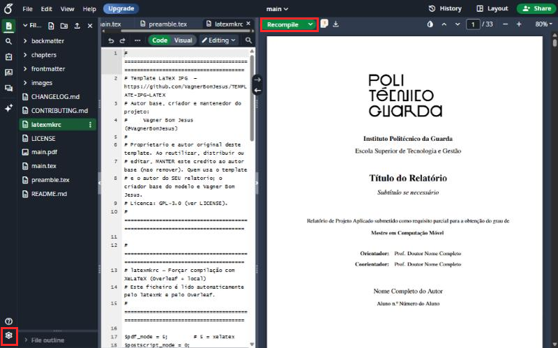
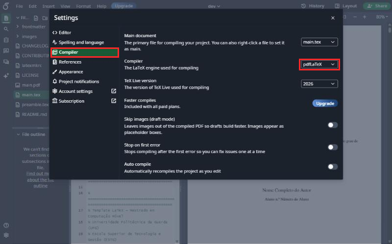
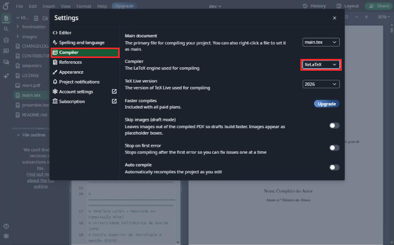

<!--
=============================================================================
Template LaTeX UPG - https://github.com/VagnerBomJesus/TEMPLATE-UPG-LATEX
Autor base, criador e mantenedor do projeto: Vagner Bom Jesus (@VagnerBomJesus)
Ao reutilizar, distribuir ou editar, MANTER o crédito ao autor base.
Licença: GPL-3.0 (ver LICENSE).
=============================================================================
-->

<p align="center">
  
</p>

# Template LaTeX - Universidade Politécnica da Guarda (UPG)

Modelo em LaTeX para dissertações, relatórios de estágio e de projeto da ESTG - Universidade Politécnica da Guarda (UPG), Portugal.

> A instituição chamava-se **Instituto Politécnico da Guarda (IPG)** e passou a **Universidade Politécnica da Guarda (UPG)**. O repositório também mudou de nome, de `TEMPLATE-IPG-LATEX` para `TEMPLATE-UPG-LATEX`; as ligações antigas são redirecionadas pelo GitHub. Os logótipos em `images/` já são os da UPG (obtidos do site oficial, sem o emblema da aliança UNITA). O modelo Word em `Doc/` é o original, ainda com a designação antiga.

Baseado no modelo oficial **Modelo_Relatório_Mestrado Computacao Movel_Pt.docx** fornecido pela instituição.

> **Autor base / criador / mantenedor:** Vagner Bom Jesus ([@VagnerBomJesus](https://github.com/VagnerBomJesus))
> **Repositório:** <https://github.com/VagnerBomJesus/TEMPLATE-UPG-LATEX>
> **Licença:** GPL-3.0 (ver [`LICENSE`](LICENSE)). Ao reutilizar ou editar, mantém o crédito ao autor base.

**Descarregar agora:** [descarregar o template completo em ZIP](https://github.com/VagnerBomJesus/TEMPLATE-UPG-LATEX/archive/refs/heads/main.zip) (um clique, pronto a usar).

---

## Índice

1. [Âmbito de utilização](#âmbito-de-utilização)
2. [Como descarregar](#como-descarregar)
3. [Usar no Overleaf - compiladores](#usar-no-overleaf---compiladores)
4. [Estrutura do projeto](#estrutura-do-projeto)
5. [Como compilar (por defeito)](#como-compilar-por-defeito)
6. [Estilo das referências - trocar o modelo](#estilo-das-referências---trocar-o-modelo)
7. [Logótipo - trocar](#logótipo---trocar)
8. [Como usar](#como-usar)
9. [Estrutura e conteúdo do relatório](#estrutura-e-conteúdo-do-relatório)
10. [Formatação](#formatação)
11. [Pacotes utilizados](#pacotes-utilizados)
12. [Perguntas frequentes (FAQ)](#perguntas-frequentes-faq)
13. [Contribuir](#contribuir)
14. [Autor e créditos](#autor-e-créditos)
15. [Licença](#licença)

---

## Âmbito de utilização

Este projeto **tem por base o modelo do Mestrado em Computação Móvel**, mas **pode ser usado por qualquer curso da Universidade Politécnica da Guarda** - CTeSP, licenciatura, mestrado ou pós-graduação - para elaborar o relatório de estágio/projeto, o Trabalho Final de Curso (TFC) ou a dissertação final.

Basta **respeitar as especificidades e regras próprias de cada curso** (estrutura exigida, tipo de trabalho, capa e requisitos da respetiva escola) e adaptar os dados em `main.tex`. O template serve igualmente qualquer escola da UPG (ESTG, ESECD, ESS, ESTH).

### Cursos da área de informática da UPG que podem usar este template

**CTeSP (nível 5):**

- Análise de Dados
- Cibersegurança
- Desenvolvimento de Aplicações Informáticas
- Infraestruturas de Cloud, Redes e Data Center
- Testes de Software
- Relacionados: Comunicação Digital, Multimédia e Artes Performativas

**Licenciaturas (1.º ciclo):**

- Engenharia Informática
- Ciência de Dados e Inteligência Artificial
- Mecânica e Informática Industrial
- Relacionado: Comunicação Multimédia

**Mestrados (2.º ciclo):**

- Computação Móvel
- Cibersegurança

> A oferta formativa da UPG muda de ano para ano. Confirma sempre a lista atualizada e as regras específicas do teu curso em [politecnicoguarda.pt](https://politecnicoguarda.pt/). Nota: Qualquer outro curso ou escola pode usar o template, adaptando a capa e a estrutura.

---

## Como descarregar

### Opção A - clonar com Git (recomendado)

```bash
git clone https://github.com/VagnerBomJesus/TEMPLATE-UPG-LATEX.git
cd TEMPLATE-UPG-LATEX
```

### Opção B - descarregar ZIP (um clique)

**[Descarregar o projeto completo em ZIP](https://github.com/VagnerBomJesus/TEMPLATE-UPG-LATEX/archive/refs/heads/main.zip)** — pronto a usar; depois é só extrair a pasta.

Em alternativa, no GitHub: botão verde **Code → Download ZIP**.

### Opção C - Editar e compilar online (sem instalar nada)

Podes usar o template diretamente no browser:

- **[Overleaf](https://www.overleaf.com/)** — **New Project → Upload Project** com o ZIP. Funciona logo com o compilador por defeito (**pdfLaTeX**); não é preciso mudar nada. Ver [Usar no Overleaf - compiladores](#usar-no-overleaf---compiladores).
- **[Prism (OpenAI)](https://prism.openai.com/)** — editor LaTeX com IA, gratuito e no browser. Também compila e faz preview.

> Nota: em compiladores no browser, as fontes Times New Roman / Calibri (do Windows/Office) podem não estar instaladas e são substituídas por equivalentes livres. O documento compila na mesma; para reproduzir exatamente as fontes oficiais, compila em local, no Windows, com XeLaTeX.

---

## Usar no Overleaf - compiladores

O template foi testado no Overleaf (TeX Live 2026, plano gratuito) e compila **sem alterações** com o compilador por defeito.

### Importar o projeto

1. Descarrega o [ZIP do projeto](https://github.com/VagnerBomJesus/TEMPLATE-UPG-LATEX/archive/refs/heads/main.zip).
2. No Overleaf: **New Project → Upload Project** e escolhe o ZIP.
3. Carrega em **Recompile**. Na primeira vez, carrega **3 ou 4 vezes** até o índice, as referências cruzadas e a bibliografia ficarem preenchidos (ver [porquê](#porque-é-preciso-carregar-em-recompile-várias-vezes)).

### Compiladores que o Overleaf suporta

O Overleaf tem quatro compiladores (motores LaTeX). Este template comporta-se assim em cada um:

| Compilador | O que é | Neste template |
|------------|---------|----------------|
| **pdfLaTeX** | O compilador **por defeito** do Overleaf. Gera o PDF diretamente; é o mais comum e compatível. Não acede às fontes do sistema. | **Funciona (por defeito no Overleaf).** Usa fontes livres equivalentes: `newtxtext` (≈ Times New Roman), Carlito (≈ Calibri) e Courier. |
| **XeLaTeX** | Motor moderno com Unicode nativo e acesso às fontes do sistema (pacote `fontspec`). | **Funciona.** Usa Times New Roman e Courier New reais; a Calibri não existe no Overleaf, por isso é usada a Carlito (mesmas métricas). |
| **LuaLaTeX** | Semelhante ao XeLaTeX (Unicode + `fontspec`), com Lua embutido. Cada passagem é mais lenta. | **Funciona.** Mesmas fontes que o XeLaTeX. |
| **LaTeX** | Motor clássico que gera DVI e só depois converte para PDF. | **Não usar.** Em modo DVI as imagens PNG (logótipo da capa e figuras) não são suportadas. |

O `preamble.tex` deteta o compilador automaticamente (pacote `iftex`) e escolhe as fontes certas - não é preciso editar nada ao trocar.

### Como trocar o compilador no Overleaf

1. Com o projeto aberto, clica no ícone **Settings** (roda dentada), no canto inferior esquerdo.

   

2. Abre o separador **Compiler** e, no campo **Compiler**, escolhe o motor. Por defeito está **pdfLaTeX**:

   

3. Para usar as fontes reais (Times New Roman / Courier New), escolhe **XeLaTeX** (ou **LuaLaTeX**):

   

4. Fecha a janela. Depois de trocar de compilador, usa a seta ao lado de **Recompile → Recompile from scratch** e a seguir carrega em **Recompile** mais 3 ou 4 vezes.

> No Overleaf, a escolha feita em **Settings → Compiler** sobrepõe-se ao `latexmkrc` e ao comentário `% !TeX program` do `main.tex`.

### Porque é preciso carregar em Recompile várias vezes

Uma compilação completa de raiz precisa de 3-4 passagens do compilador mais o `biber` (cerca de 11 s), e o plano gratuito do Overleaf interrompe a compilação por volta dos 10 s com o erro **"Your project needs more compile time"**. Para evitar isso, o `latexmkrc` limita - **só no Overleaf** - cada compilação a uma passagem (2 a 4 s). Por isso:

- nas primeiras compilações o PDF aparece com `??` ou `[?]` no lugar das referências e sem índice - é normal;
- carrega em **Recompile** até desaparecerem (3 ou 4 vezes na primeira vez);
- depois disso, cada alteração precisa normalmente de um só **Recompile** (mais um ou dois se mexeres em citações ou referências cruzadas).

Em compilação local este limite não se aplica: o `latexmk` faz todas as passagens de uma vez.

### Erros comuns no Overleaf

| Mensagem | Causa | Solução |
|----------|-------|---------|
| `Fatal Package fontspec Error: The fontspec package requires either XeTeX or LuaTeX` | Versão antiga do template (só XeLaTeX) compilada com pdfLaTeX. | Atualiza o `preamble.tex` para a versão atual, ou muda o compilador para **XeLaTeX** em **Settings → Compiler**. |
| `Your project needs more compile time` | A compilação excedeu o tempo do plano gratuito. | Confirma que o `latexmkrc` do projeto é o atual e carrega de novo em **Recompile**. |
| Referências com `[?]` / índice vazio | Ainda faltam passagens. | Carrega em **Recompile** mais uma ou duas vezes. |
| `No PDF` com o compilador **LaTeX** | O modo DVI não suporta PNG. | Escolhe **pdfLaTeX**, **XeLaTeX** ou **LuaLaTeX**. |

---

## Estrutura do projeto

```
TEMPLATE-UPG-LATEX/
├── main.tex                          # Ficheiro principal (compilar este)
├── preamble.tex                      # Pacotes, configurações, estilos e estilo das referências
├── latexmkrc                         # XeLaTeX em local; no Overleaf, uma passagem por compilação
├── .gitignore                        # Ignora ficheiros auxiliares
├── LICENSE                           # GPL-3.0
├── README.md                         # Este ficheiro
├── CONTRIBUTING.md                   # Regras para contribuir
│
├── frontmatter/                      # Páginas iniciais
│   ├── capa.tex                      # Capa (2 logótipos prontos: comentar/descomentar)
│   ├── citacao.tex                   # Citação
│   ├── dedicatoria.tex               # Dedicatória (opcional)
│   ├── agradecimentos.tex            # Agradecimentos
│   ├── resumo.tex                    # Resumo + palavras-chave (PT)
│   ├── abstract.tex                  # Abstract + keywords (EN)
│   └── simbolos_acronimos.tex        # Símbolos e Acrónimos (opcional)
│
├── chapters/                         # Capítulos
│   ├── 01_introducao.tex
│   ├── 02_trabalho_relacionado.tex   # inclui exemplos de citação
│   ├── 03_desenvolvimento.tex
│   ├── 04_testes_resultados.tex      # inclui figura de exemplo (image3.png)
│   └── 05_conclusoes.tex
│
├── backmatter/                       # Páginas finais
│   ├── bibliografia.tex              # \printbibliography (+ \nocite{*})
│   ├── referencias.bib               # Base de dados de referências
│   └── anexos.tex
│
├── docs/overleaf/                    # Prints usados neste README (troca de compilador)
│
├── images/                           # Imagens e logótipos
│   ├── image1.png                    # Logótipo UPG vertical (empilhado)
│   ├── image2.png                    # Logótipo UPG horizontal (uma linha)
│   └── image3.png                    # Figura de exemplo (tipos de gráficos)
│
└── Doc/                              # Modelo Word original da UPG
    └── Modelo_Relatório_Mestrado Computacao Movel_Pt.docx
```

---

## Como compilar (por defeito)

### Pré-requisitos

- [TeX Live](https://www.tug.org/texlive/) (completo) ou [MiKTeX](https://miktex.org/)
- Compilador: **`xelatex`** (recomendado em local). Também compila com `lualatex` e `pdflatex`.
- Gestor de bibliografia: **`biber`**
- Para o aspeto oficial: fontes **Times New Roman**, **Calibri** e **Courier New** (Windows/Office)

> Em local, o template usa por defeito o **XeLaTeX** para aceder diretamente às fontes do sistema e reproduzir fielmente o modelo Word oficial da UPG. Com `pdflatex` (ou fora do Windows, onde não há Calibri) são usadas fontes livres equivalentes - ver [Usar no Overleaf - compiladores](#usar-no-overleaf---compiladores).

### Sequência de compilação (obrigatória por causa das referências)

```bash
xelatex main.tex
biber main
xelatex main.tex
xelatex main.tex
```

### Com latexmk (recomendado)

O ficheiro `latexmkrc` já define o XeLaTeX, por isso basta:

```bash
latexmk main.tex
```

Limpar os ficheiros auxiliares:

```bash
latexmk -c
```

> **Importante:** se só correres `xelatex` uma vez (sem o `biber`), a secção de referências fica vazia. Corre sempre a sequência completa - ou usa o `latexmk`.

---

## Estilo das referências - trocar o modelo

**Por defeito o template usa o estilo IEEE** (numérico: `[1]`, `[2]`, ordenado por ordem de citação).

Para trocar de estilo, abre o [`preamble.tex`](preamble.tex), secção **"ESTILO DAS REFERÊNCIAS"**. Estão lá **4 blocos** prontos: deixa **um** ativo e **comenta os outros** com `%`.

| Estilo | Como fica | Bloco no `preamble.tex` | Pacote necessário |
|--------|-----------|--------------------------|-------------------|
| **IEEE** *(ativo por defeito)* | `[1]`, `[2]`, por ordem de citação | `style=ieee, sorting=none` | `biblatex-ieee` |
| APA 7.ª ed. | `(Autor, ano)` autor-data | `style=apa, sorting=nyt` | `biblatex-apa` |
| Autor-data / Harvard (NP 405) | `(Autor, ano)` | `style=authoryear, sorting=nyt` | (base) |
| Numérico simples | `[1]` ordenado por nome | `style=numeric-comp, sorting=nyt` | (base) |

Passos:

1. Comentar (`%`) o bloco IEEE e descomentar o bloco desejado (só **um** ativo).
2. Apagar os ficheiros auxiliares (`.aux`, `.bbl`, `.bcf`, `.run.xml`).
3. Recompilar a sequência completa (`xelatex → biber → xelatex → xelatex`, ou `latexmk`).

> Todos os blocos mantêm `natbib=true`, por isso `\citet{}`/`\citep{}` funcionam em qualquer estilo. Em IEEE o comando idiomático é `\cite{}` (dá `[1]`).

### Mostrar todas as referências vs. só as citadas

O `backmatter/bibliografia.tex` tem `\nocite{*}`, que imprime **todas** as entradas do `.bib` (útil para ver o modelo). Para listar **apenas** as referências efetivamente citadas no texto, comenta ou remove essa linha.

---

## Logótipo - trocar

A capa ([`frontmatter/capa.tex`](frontmatter/capa.tex)) já traz **os dois logótipos prontos**, um ativo e o outro comentado. Para trocar, basta inverter o `%`:

```latex
% Opção 1 - vertical/empilhado:
\includegraphics[width=6cm]{image1.png}
%
% Opção 2 - horizontal, numa linha:
% \includegraphics[width=12cm]{image2.png}
```

---

## Como usar

### 1. Preencher os dados em `main.tex`

```latex
\newcommand{\tituloRelatorio}{Título do Meu Relatório}
\newcommand{\subtituloRelatorio}{Subtítulo se necessário}
\newcommand{\nomeAutor}{Nome Completo do Autor}
\newcommand{\numeroAluno}{Número do Aluno}
\newcommand{\nomeOrientador}{Prof. Doutor Nome Orientador}
\newcommand{\nomeCoorientador}{Prof. Doutor Nome Coorientador} % remover da capa se não houver
\newcommand{\mesAno}{Junho | 2025}
\newcommand{\anoLetivo}{2024/2025}
\newcommand{\tipoRelatorio}{Relatório de Projeto Aplicado} % ou: Estágio Profissionalizante | Dissertação
```

### 2. Editar os capítulos

Editar os ficheiros em `chapters/` seguindo as orientações em comentário em cada um.

### 3. Gerir referências

Adicionar entradas em `backmatter/referencias.bib` e citar no texto com `\cite{chave}` (IEEE → `[n]`), ou `\citet{chave}`/`\citep{chave}`.

### 4. Adicionar imagens

Colocar em `images/` e incluir com:

```latex
\begin{figure}[htbp]
    \centering
    \includegraphics[width=0.8\textwidth]{nome_ficheiro.png}
    \caption{Descrição da figura \citep{chave}.} % citar se for de outro autor
    \label{fig:identificador}
\end{figure}
```

Referenciar sempre no texto com `Figura~\ref{fig:identificador}`.

### 5. Secções opcionais

- **Dedicatória** - apagar `\input{frontmatter/dedicatoria}` em `main.tex` se não aplicável.
- **Coorientador** - remover da capa em `frontmatter/capa.tex` se não existir.
- **Símbolos / Acrónimos** - remover subsecções em `frontmatter/simbolos_acronimos.tex` se não aplicável.
- **Anexos** - adicionar/remover em `backmatter/anexos.tex`.

---

## Estrutura e conteúdo do relatório

O template segue a estrutura do modelo oficial UPG para o Mestrado em Computação Móvel:

| Secção | Ficheiro | Notas |
|--------|----------|-------|
| Capa | `frontmatter/capa.tex` | Título, autor, n.º aluno, orientadores, instituição, data |
| Citação | `frontmatter/citacao.tex` | Frase à escolha |
| Dedicatória | `frontmatter/dedicatoria.tex` | **Opcional** |
| Agradecimentos | `frontmatter/agradecimentos.tex` | Orientadores, escola, família, etc. |
| Resumo | `frontmatter/resumo.tex` | Máx. 400 palavras + palavras-chave (PT) |
| Abstract | `frontmatter/abstract.tex` | Máx. 400 palavras + keywords (EN) |
| Índices (geral, figuras, tabelas) | `main.tex` | Gerados automaticamente |
| Símbolos e Acrónimos | `frontmatter/simbolos_acronimos.tex` | **Opcional** |
| Cap. 1 - Introdução | `chapters/01_introducao.tex` | Contexto/Motivação, Problema/Objetivos, Solução, Organização |
| Cap. 2 - Trabalho Relacionado | `chapters/02_trabalho_relacionado.tex` | Métodos/Tecnologias, Soluções Existentes |
| Cap. 3 - Desenvolvimento | `chapters/03_desenvolvimento.tex` | Requisitos, Arquitetura, Módulos, Protótipo |
| Cap. 4 - Testes e Resultados | `chapters/04_testes_resultados.tex` | Teste A, Teste B, …, Discussão |
| Cap. 5 - Conclusões | `chapters/05_conclusoes.tex` | Síntese, Contribuições, Limitações, Trabalho Futuro |
| Referências | `backmatter/bibliografia.tex` | Estilo IEEE por defeito |
| Anexos | `backmatter/anexos.tex` | Material suplementar |

Cada ficheiro traz, em comentário, as perguntas-guia a responder em cada secção (contexto, problema, objetivos mensuráveis, arquitetura, tipos de teste, etc.).

### O que escrever em cada capítulo

- **Cap. 1 - Introdução:** contexto e motivação do trabalho, definição do problema e objetivos (mensuráveis), solução proposta (visão de alto nível e tecnologias) e organização do relatório.
- **Cap. 2 - Trabalho Relacionado:** estado da arte - métodos e tecnologias relevantes, soluções existentes e sua comparação, e a lacuna que o projeto vem preencher. Inclui exemplos de citação.
- **Cap. 3 - Desenvolvimento:** análise de requisitos, arquitetura do sistema (diagrama de módulos e fluxos), implementação de cada módulo (com figuras, tabelas, equações e excertos de código) e protótipo final.
- **Cap. 4 - Testes e Resultados:** testes de validação, verificação e avaliação - o que se testou, como foi preparado/executado, resultados (tabelas, figuras, equações) e discussão. Inclui uma figura de exemplo (`image3.png`).
- **Cap. 5 - Conclusões:** síntese do trabalho (problema + solução), resumo dos resultados, contribuições para o estado da arte, limitações e sugestões de trabalho futuro.

---

## Formatação

| Elemento | Configuração |
|----------|-------------|
| Corpo do texto | Times New Roman, 12pt |
| Heading 1 (`\chapter`) | Calibri Bold, 18pt |
| Heading 2 (`\section`) | Calibri Bold, 16pt |
| Heading 3 (`\subsection`) | Calibri Bold, 14pt |
| Heading 4 (`\subsubsection`) | Calibri, 12pt |
| Cabeçalhos, rodapés e legendas | Calibri, 10pt |
| Código fonte | Courier New |
| Espaçamento | 1,5 linhas |
| Margens | A4 - sup./inf. 2,5 cm; interior 3 cm; exterior 2,5 cm |
| Numeração de páginas | Romana no frontmatter; árabe nos capítulos |
| Figuras/tabelas/equações | Numeradas por capítulo: `Figura 3.1`, `Tabela 4.1`, `(4.1)` |
| Legendas | Formato: `Figura X.Y - Título` (separador a traço médio) |
| Cor do texto | **Todo o documento a preto** (sem azul nem vermelho; hiperligações também a preto) |

> A cor institucional azul UPG (`#00467F`) continua **definida** no `preamble.tex` (`azulUPG`) mas não está aplicada. Para a usar nalgum elemento, basta aplicar `\color{azulUPG}` (o nome antigo `azulIPG` continua a funcionar).

### Regras para equações

- Numerar todas as equações para referência no texto.
- Descrever **todas as variáveis** a seguir à equação (lista "Onde:").
- Variáveis sempre em **itálico**, na equação e no texto.

### Regras para figuras e tabelas

- Incluir **referência bibliográfica** na legenda quando a figura/tabela for de outro autor.
- Referenciar sempre a figura/tabela no texto (`Figura~\ref{...}`).

---

## Pacotes utilizados

| Pacote | Finalidade |
|--------|-----------|
| `iftex` | Deteta o compilador (pdfLaTeX / XeLaTeX / LuaLaTeX) para escolher as fontes |
| `fontspec` | Fontes do sistema (Times New Roman, Calibri, Courier New) - só com XeLaTeX/LuaLaTeX |
| `newtxtext` / `carlito` | Fontes equivalentes (≈ Times New Roman / ≈ Calibri) - só com pdfLaTeX |
| `babel` | Língua portuguesa |
| `titlesec` | Formatação dos headings |
| `geometry` | Margens A4 |
| `fancyhdr` | Cabeçalhos e rodapés (Calibri 10pt) |
| `graphicx` | Inclusão de imagens |
| `booktabs` / `array` / `longtable` | Tabelas |
| `amsmath` / `amssymb` | Matemática |
| `listings` | Código fonte |
| `hyperref` | Hiperligações e metadados do PDF |
| `biblatex` + `biber` | Referências (**IEEE** por defeito; APA/autor-data/numérico opcionais) |
| `csquotes` | Aspas (recomendado pelo biblatex) |
| `xcolor` | Cores (`azulUPG` definido) |
| `caption` / `subcaption` | Legendas e subfiguras |
| `setspace` / `indentfirst` | Espaçamento e indentação |
| `pdfpages` | Inclusão de PDFs nos anexos |
| `chngcntr` | Numeração de figuras/tabelas/equações por capítulo |
| `glossaries` | Glossário automático - **opcional**, vem comentado no `preamble.tex` |

---

## Perguntas frequentes (FAQ)

**Como escrevo o meu relatório, tese ou dissertação da UPG em LaTeX?**
Descarrega este template, abre o `main.tex`, preenche os teus dados e edita os capítulos em `chapters/`. Compila com XeLaTeX + biber (ou `latexmk`), ou diretamente no Overleaf.

**Este template serve para o meu curso?**
Sim. Tem por base o Mestrado em Computação Móvel, mas serve qualquer curso da Universidade Politécnica da Guarda (CTeSP, licenciatura, mestrado ou pós-graduação) - ver [Âmbito de utilização](#âmbito-de-utilização). Respeita sempre as regras específicas do teu curso.

**Preciso de saber LaTeX?**
Não muito. O template já está montado; na maioria dos casos só preenches texto e segues os comentários-guia em cada ficheiro.

**Posso usar no Overleaf ou só localmente?**
Ambos. Em local, o `latexmkrc` já usa o XeLaTeX. No Overleaf funciona logo com o compilador por defeito (pdfLaTeX) e também com XeLaTeX e LuaLaTeX. Ver [Usar no Overleaf - compiladores](#usar-no-overleaf---compiladores).

**Que estilo de referências usa? Posso mudar para APA?**
Por defeito usa **IEEE**. Podes trocar para APA, autor-data (Harvard/NP 405) ou numérico simples - ver [Estilo das referências](#estilo-das-referências---trocar-o-modelo).

**Que fontes preciso de ter instaladas?**
Para o aspeto oficial: Times New Roman, Calibri e Courier New (incluídas no Windows/Office), com **XeLaTeX**. Se não as tiveres (Overleaf, Linux, macOS) ou usares `pdflatex`, o template usa automaticamente fontes livres equivalentes.

**As referências não aparecem, porquê?**
Falta correr o `biber`. Usa a sequência `xelatex` -> `biber` -> `xelatex` -> `xelatex` (ou `latexmk`). No Overleaf, carrega em **Recompile** mais algumas vezes.

**No Overleaf aparece "Your project needs more compile time" ou um erro do `fontspec`. O que faço?**
Ver [Erros comuns no Overleaf](#erros-comuns-no-overleaf).

**É gratuito? Posso usar no meu relatório final?**
Sim, é livre sob licença GPL-3.0, mantendo o crédito ao autor base.

---

## Contribuir

As contribuições são bem-vindas - o objetivo é manter este template **100% atualizado e correto** com a informação oficial da UPG. Antes de abrir um *pull request*, lê o [`CONTRIBUTING.md`](CONTRIBUTING.md), que descreve as regras, parâmetros e o fluxo de trabalho.

---

## Autor e créditos

**Autor base, criador e mantenedor:** Vagner Bom Jesus - [@VagnerBomJesus](https://github.com/VagnerBomJesus)

Este template e projeto foram criados e são mantidos por Vagner Bom Jesus. Cada pessoa que usa o template é autora do **seu próprio relatório**, mas o **criador base do modelo** é Vagner Bom Jesus - crédito preservado no cabeçalho de todos os ficheiros e nos metadados do PDF gerado. Ao reutilizar, distribuir ou adaptar, mantém este crédito.

## Instituição

- **Instituição:** Universidade Politécnica da Guarda (UPG)
- **Escola:** Escola Superior de Tecnologia e Gestão (ESTG)
- **Curso (base):** Mestrado em Computação Móvel
- **Website:** [politecnicoguarda.pt](https://politecnicoguarda.pt/)

## Licença

Distribuído sob a licença **GPL-3.0** - ver [`LICENSE`](LICENSE). Uso livre para estudantes e docentes, mantendo o crédito ao autor base.

---

**Palavras-chave:** template LaTeX UPG · modelo de tese e dissertação UPG · Universidade Politécnica da Guarda · antigo IPG (Instituto Politécnico da Guarda) · relatório de estágio ESTG · template LaTeX Overleaf Politécnico da Guarda · XeLaTeX · biblatex · Mestrado em Computação Móvel · Engenharia Informática · Ciência de Dados e Inteligência Artificial · Cibersegurança · CTeSP · thesis template Portugal.
